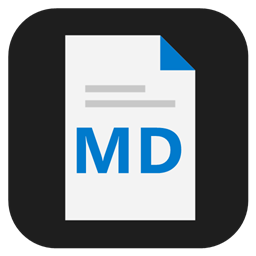

# MdViewer

Visor de escritorio de archivos Markdown (`.md`) con estética de Visual Studio Code. Abrí una carpeta, navegá entre sus documentos y seguí leyendo exactamente donde lo dejaste.



## Características

- **Proyectos:** cada carpeta que agregás se guarda como un "proyecto".
- **Retoma la lectura:** por proyecto recuerda el archivo abierto y la línea/posición donde quedaste.
- **Navegación:** árbol de archivos lateral, enlaces relativos entre `.md` (incluidos anclas `#título`) e historial atrás/adelante.
- **Enlaces externos:** `http`, `https` y `mailto` se abren en el navegador o programa del sistema.
- **Búsqueda en el documento** (`Ctrl+F`).
- **Modo edición** con vista previa en vivo lado a lado, barra de formato (negrita, cursiva, tachado, títulos, listas, tareas, citas, código, enlaces, imágenes, tablas y línea horizontal), resaltado de sintaxis Markdown y aviso si hay cambios sin guardar.
- **Resaltado de sintaxis** en bloques de código.
- **Diagramas Mermaid:** los bloques ```` ```mermaid ```` se dibujan como imagen (flowchart, secuencia, clases, estado, ER, Gantt, etc.), siguen el tema claro/oscuro y funcionan sin internet. Si un diagrama tiene errores, se muestra el mensaje y el código. Usa [Mermaid](https://mermaid.js.org/) (MIT) dentro de un WebView oculto: en Windows requiere WebView2 Runtime (viene con Windows 10/11).
- **Tema claro y oscuro** inspirados en VS Code (Light+ y Dark+).
- Tablas, citas, listas, tareas, imágenes locales, negrita, cursiva y tachado.

## Descarga

Andá a la sección [Releases](../../releases) y elegí una de las opciones:

| Archivo | Para quién |
|---|---|
| `MdViewer-X.Y.Z-win-x64-setup.exe` | **Instalador.** Crea accesos directos y se desinstala desde Windows. Se instala por usuario, sin permisos de administrador. |
| `MdViewer-X.Y.Z-win-x64-portable.zip` | **Portable.** Descomprimí y ejecutá `MdViewer.exe`, sin instalar nada. |

Ambos incluyen el runtime de .NET: **no necesitás instalar nada más**. Los hashes SHA-256 están en `SHA256SUMS.txt`.

> Si Windows SmartScreen muestra una advertencia, es porque el ejecutable no está firmado digitalmente. Elegí "Más información" → "Ejecutar de todas formas".

## Uso

1. Tocá **Agregar carpeta…** y elegí una carpeta con archivos `.md`.
2. Navegá desde el árbol o haciendo clic en los enlaces del documento.
3. Cerrá la app cuando quieras: al volver se abre el último proyecto, en el mismo archivo y posición.

### Atajos

| Atajo | Acción |
|---|---|
| `Ctrl+F` | Buscar en el documento |
| `Enter` / `F3` | Siguiente resultado |
| `Shift+Enter` | Resultado anterior |
| `Esc` | Cerrar la búsqueda |
| `Alt+←` / `Alt+→` | Atrás / adelante |
| `Ctrl+E` | Alternar entre vista y edición |
| `Ctrl+S` | Guardar (en edición) |
| `Ctrl+Shift+B` | Mostrar/ocultar la barra lateral (☰) |
| `Ctrl+Shift+P` | Mostrar/ocultar la vista previa en edición (editor a pantalla completa) |
| `Ctrl+B` / `Ctrl+I` / `Ctrl+K` | Negrita / cursiva / enlace (en edición) |

## Datos guardados

La lista de proyectos, la posición de lectura y las preferencias se guardan en:

```
%APPDATA%\MdViewer\state.json
```

Borrar ese archivo restablece la aplicación.

## Compilar desde el código

Requisitos: [.NET 10 SDK](https://dotnet.microsoft.com/download/dotnet/10.0).

```powershell
git clone https://github.com/gabri86/MdViewer.git
cd MdViewer
dotnet run
```

Generar el ejecutable portable autocontenido:

```powershell
dotnet publish MdViewer.csproj -c Release -r win-x64 --self-contained true `
  -p:PublishSingleFile=true -p:IncludeNativeLibrariesForSelfExtract=true -o publish
```

## Publicar una versión

Los releases se generan automáticamente con GitHub Actions ([release.yml](.github/workflows/release.yml)) al subir una etiqueta `v*`:

```powershell
git tag v1.0.0
git push origin v1.0.0
```

El workflow compila, crea el `.zip` portable y el instalador (Inno Setup), y los adjunta al release.

## Tecnologías

[.NET 10](https://dotnet.microsoft.com/) · [Avalonia UI](https://avaloniaui.net/) · [Markdig](https://github.com/xoofx/markdig)
